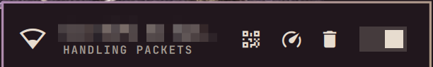
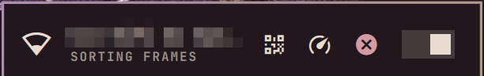

# Omarchy Wi-Fi Forget

An [Omarchy](https://omarchy.org) shell plugin that adds a **Forget** button to
the Wi-Fi control panel. One button disconnects you from the current network
and deletes its saved NetworkManager profile, including the stored passphrase.



Click it once and it arms, turning red. Click again within 4 seconds to forget
the network:



## Why

Omarchy's network panel can forget saved networks, but only ones you're **not**
connected to. To forget the network you're on, you had to disconnect first,
wait for the row to update, then forget it, or drop to `nmcli connection
delete`. This plugin makes that a single action in the panel.

## Features

- **Forget button in the panel header.** A trash can next to the QR-code and
  speed-test buttons, shown whenever you're connected to a saved Wi-Fi network.
- **Two-step confirmation.** The first click arms the button: it turns into a
  red ✕, and the tooltip names the network. A second click within 4 seconds
  commits. Moving the mouse away, closing the panel, or switching networks
  disarms it.
- **Keyboard support.** Press `f` twice, or move to the button with the
  arrow keys / `h` `j` `k` `l` and press Enter twice.
- **Forget from the network list.** The ✕ that appears when you hover a row's
  lock icon now works on the connected network too, not just on saved networks
  you're away from. Like the stock ✕, it forgets on the first click.

Everything else in the panel is unchanged: details, speed test, QR sharing,
band and DNS selection, and the network list.

## Requirements

- Omarchy 4.x with the Quickshell-based `omarchy-shell` (built and tested on
  Omarchy 4.0.4 with Quickshell 0.3.1)
- NetworkManager (Omarchy's default network backend)

## Installation

### From GitHub

```bash
omarchy plugin add https://github.com/jsprada/omarchy-wifi-forget.git --enable --yes
```

### From a local checkout

```bash
git clone https://github.com/jsprada/omarchy-wifi-forget.git
cd omarchy-wifi-forget
./install.sh
```

`install.sh` validates the plugin, copies `manifest.json`, `Panel.qml` and
`Model.js` to `~/.config/omarchy/plugins/johnny.wifi-forget/`, and enables it.
Run it again to deploy local changes; the shell reloads plugin code
automatically.

Use one install method, not both. Both install to the same folder.

Either way, the plugin replaces the stock network widget in place in your bar.
Your Wi-Fi keybind and `omarchy.network` IPC calls open the new panel.

## Uninstall

```bash
omarchy plugin remove johnny.wifi-forget --yes
```

This puts the stock `omarchy.network` widget back where it was.

## How it works

An Omarchy plugin can't add a button to a built-in panel. Instead, this plugin
is a copy of Omarchy's network panel
(`/usr/share/omarchy/shell/plugins/panels/network/`) with a small set of changes
added. Its manifest declares:

```json
"omarchy": { "clonedFrom": "omarchy.network" }
```

That's the same mechanism `omarchy plugin clone` uses. Enabling the plugin swaps
it in for the stock widget, and the shell routes calls aimed at
`omarchy.network` to it.

The forget action calls Quickshell's `WifiNetwork.forget()`, which deletes the
network's NetworkManager connection profiles. When the deleted profile is the
active one, NetworkManager shuts the connection down. That one call both drops
the link and erases the stored credentials. It's the same as running:

```bash
nmcli connection delete "<SSID>"
```

### Files

| File               | Purpose                                                          |
|--------------------|------------------------------------------------------------------|
| `manifest.json`    | Plugin manifest (`bar-widget`, cloned from `omarchy.network`)    |
| `Panel.qml`        | The network panel, with the Forget button added                  |
| `Model.js`         | Panel helpers; `canForgetNetwork` now allows connected networks  |
| `forget.patch`     | Every change from the stock panel, as a unified diff             |
| `install.sh`       | Copies the plugin into `~/.config/omarchy/plugins/` and enables it |
| `sync-upstream.sh` | Rebuilds the panel from the installed Omarchy and re-applies the patch |

## Keeping up with Omarchy updates

`Panel.qml` and `Model.js` are copied from Omarchy 4.0.4, so later fixes to the
stock network panel won't show up here on their own. Every change this plugin
makes is in `forget.patch`. After an Omarchy update, run:

```bash
./sync-upstream.sh && ./install.sh
```

`sync-upstream.sh` copies the stock panel from your installed Omarchy and
re-applies the patch. If the patch no longer applies cleanly, it stops without
changing anything and you'll need to merge the changes by hand. Then
regenerate the patch from the stock files.

## License

MIT. See [LICENSE](LICENSE). The panel code comes from
[Omarchy](https://github.com/basecamp/omarchy), which is also MIT licensed.
